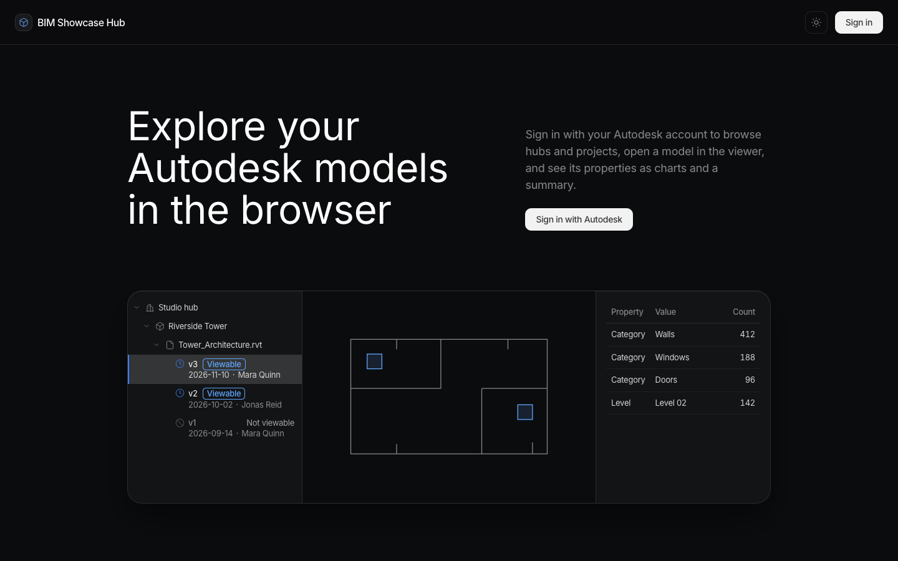
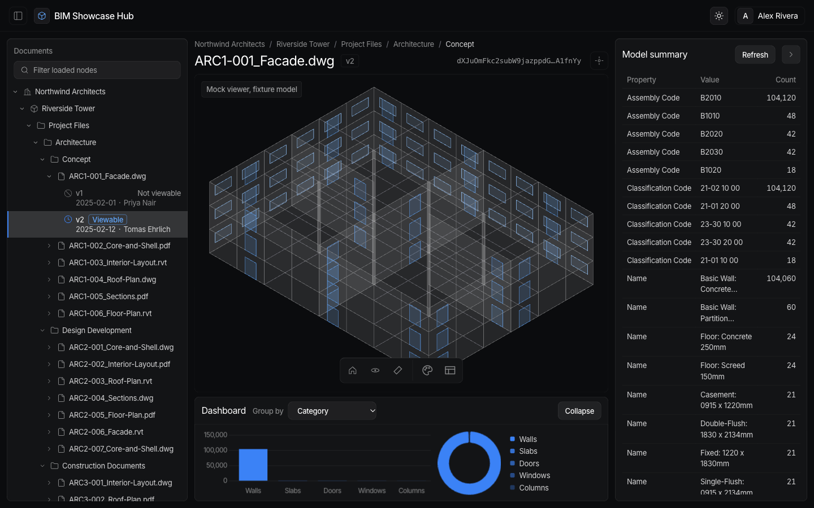
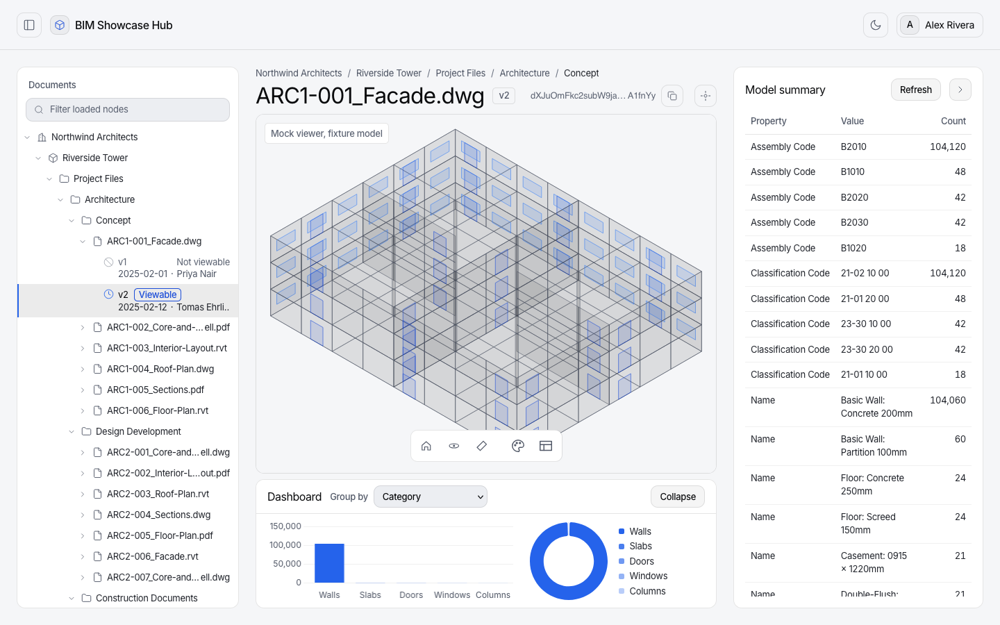

# BIM Showcase Hub

A browser workspace for Autodesk Platform Services (APS) models. Sign in with an Autodesk account, browse hubs, projects, folders and versions, open a model in the Autodesk Viewer, and read its properties as a summary table and charts. Selected elements can be painted and the property table exported to Excel from the viewer toolbar, in a dark or light theme.







The screenshots use the built-in mock data, not a real account.

## Features

- Autodesk three-legged sign-in with a cookie session. Tokens never reach the browser except a short-lived viewer token.
- Documents first: the app opens on the document tree alone, and selecting a model version opens the viewer next to it with the summary and dashboard. Closing the last model goes back to Documents.
- Dockable workspace: move, resize, tab, collapse and float the document tree, the viewer, the summary and the dashboard inside the page, with a menu and keyboard path for every move, a Panes menu to reopen closed panes, Reset layout, and the arrangement saved per browser. Below 876px the panes stack and the tree becomes an overlay.
- Lazy document tree for hubs, projects, folders, items and versions, with filtering and keyboard navigation.
- Autodesk Viewer for any viewable version, in the US or EU region. Several models open at once, each in its own viewer tab: compare two side by side by dragging a tab, and the summary, dashboard and URL follow the active one. Open tabs come back after a reload and load when first shown.
- Combined viewer: pick several versions in Documents (Ctrl or Cmd click, Shift click or Space) and open them together in one viewer and one scene, aligned by shared coordinates, up to six models. Add a version to the open viewer from its row, hide or remove models from the Models menu, and switch the summary and dashboard between all models and one model. A model that fails to load says why and leaves the others in place.
- Tool group inside the viewer toolbar: paint selected elements red, green or blue (or reset), and export to Excel, with an in-viewer status badge for the export.
- Dark and light themes with a top bar toggle. The choice is remembered, the viewer, including its native toolbar and panels, and the charts follow it.
- Model summary: element counts grouped by Assembly Code, Classification Code and Name, in a pane that collapses to give the viewer more room.
- Dashboard: bar chart and donut chart of elements by Category, Level, Assembly Code, Classification Code or Name.
- Excel export: one sheet per Category with selected properties, built in the browser, with a Model column when the viewer holds several models. The viewer keeps its model and resizes when panes move, float, open, close or collapse.
- Mock mode with fixture hubs and a fake viewer, so the whole app runs without Autodesk credentials.

## Quick start (mock mode)

Requires Node 24.

```bash
npm install
npm run dev:mock
```

Open http://localhost:5173. The app signs you in as a mock user and serves fixture data. Mock mode works only in development. A production build ignores `MOCK_APS`.

## Real credentials

Create an APS app, copy `.env.example` to `.env`, fill in the values and run `npm run dev`. See [docs/development.md](docs/development.md) for the variables and [docs/deployment.md](docs/deployment.md) for the APS app setup.

## Scripts

| Script               | What it does                                                                        |
| -------------------- | ----------------------------------------------------------------------------------- |
| `npm run dev`        | Express server with `tsx watch` plus Vite on port 5173                              |
| `npm run dev:mock`   | Same, with mock data and the mock viewer                                            |
| `npm run build`      | Type-check the web app, build it to `dist/web`, compile the server to `dist/server` |
| `npm start`          | Run the compiled server, which also serves `dist/web`                               |
| `npm run lint`       | Biome check                                                                         |
| `npm run format`     | Biome check with fixes                                                              |
| `npm run typecheck`  | TypeScript for the server and the web app                                           |
| `npm test`           | Vitest                                                                              |
| `npm run e2e:setup`  | Create the Camoufox Python environment for end-to-end tests                         |
| `npm run e2e:signin` | Open a browser to sign in once for the real-app tests                               |
| `npm run e2e:smoke`  | Run the smoke test against the real app                                             |

## Project layout

```
api/            Vercel function entry (api/index.ts)
docs/           Guides and screenshots
e2e/            Camoufox end-to-end scripts (Python)
public/         Static assets
src/server/     Express app: config, auth, data mapping, routes, mock data
src/shared/     Types shared by server and web
src/web/        React app: routes, components, panels, viewer adapters, extensions, styles
DESIGN.md       Design tokens and rules
vercel.json     Vercel build output and rewrites
```

## Documentation

- [Architecture](docs/architecture.md)
- [Development](docs/development.md)
- [Deployment](docs/deployment.md)
- [Design system](docs/design-system.md)
- [Layout](docs/layout.md)
- [Viewer extensions](docs/extensions.md)

## License

MIT. See [LICENSE](LICENSE).
